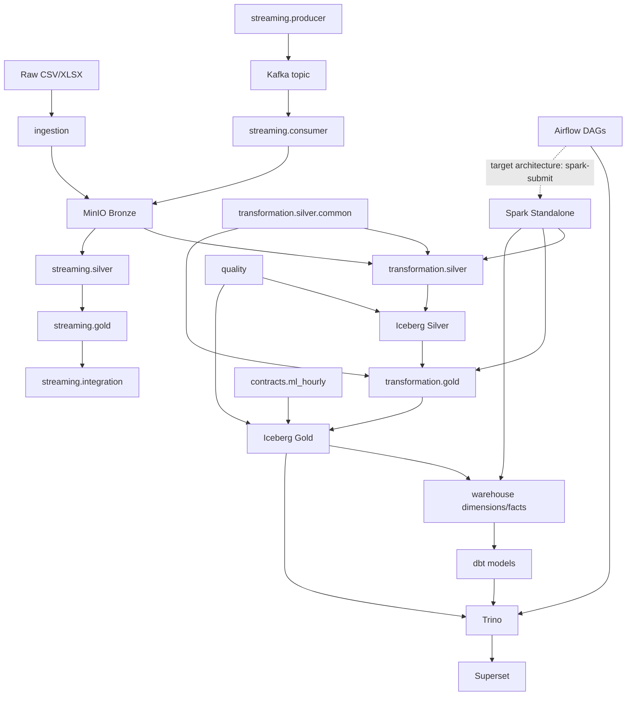

# PHÂN TÍCH CẤU TRÚC THƯ MỤC DỰ ÁN

## 1. Phạm vi khảo sát

Báo cáo dựa trên source code, cấu hình, Docker Compose, Airflow DAG, dbt manifest và tài liệu trong repository. Đã loại trừ `.git`, `.venv`, `node_modules`, `__pycache__`, `.pytest_cache`, dbt `target/`, Airflow logs, `data/`, `reports/` và `.env`. Không hiển thị secrets, credentials hoặc API keys.

Repository là nền tảng data lakehouse; không tìm thấy frontend hoặc business REST API.

## 2. Cây thư mục hiện tại

```text
TLCN/
├── airflow/
│   ├── dags/
│   │   ├── lakehouse_batch_pipeline.py
│   │   ├── lakehouse_quality_monitoring.py
│   │   └── lakehouse_streaming_monitoring.py
│   └── docker-compose.yml
├── config/
│   ├── sources.yaml
│   ├── quality_rules.yaml
│   ├── silver_rules.yaml
│   ├── gold_quality_rules.yaml
│   └── gold_hourly_hydrology_contract.yaml
├── contracts/ml_hourly/
│   ├── data_contract.yaml
│   ├── README.md
│   ├── validate_ml_contract.py
│   └── validation_report.json
├── dbt/flood_analytics/
│   ├── dbt_project.yml
│   ├── profiles.yml
│   ├── models/
│   │   ├── staging/*.sql, sources.yml
│   │   ├── intermediate/*.sql
│   │   └── marts/*.sql, schema.yml
│   └── tests/*.sql
├── demo/iceberg/
│   ├── setup_iceberg_demo.py
│   ├── demo_snapshot.py
│   ├── demo_time_travel.py
│   ├── demo_acid.py
│   ├── demo_schema_evolution.py
│   ├── demo_partitioned_table.py
│   ├── demo_partition_metadata.py
│   └── verify_*.py
├── docker/
│   ├── hive/{Dockerfile.hive3, core-site.xml, *.jar}
│   ├── kafka/docker-compose.yml
│   └── superset/Dockerfile
├── docs/data_source_catalog.md
├── ingestion/
│   ├── batch/ingest_to_bronze.py
│   └── backfill/{backfill_open_meteo.py, ingest_backfill_to_bronze.py}
├── profiling/inventory_sources.py
├── quality/
│   ├── validate_*.py
│   ├── analyze_*.py
│   ├── investigate_*.py
│   └── inspect_*.py / verify_*.py
├── scripts/inspect_mrc_water_level.py
├── streaming/
│   ├── producer/{replay_water_level.py, inspect_water_level.py}
│   ├── consumer/kafka_to_bronze.py
│   ├── silver/bronze_to_silver.py
│   ├── gold/silver_to_hourly.py
│   ├── integration/{build_integrated.py, merge_integrated.py}
│   ├── quality/{rules.py, validate_*.py, inspect_*.py}
│   └── demo/{preflight.py, validation_gate.py, check_idempotency.py, ...}
├── test/{test_*.py, check_*.py}
├── transformation/
│   ├── silver/{common.py, run_silver.py, transform_to_silver.py, *_to_silver.py}
│   └── gold/{build_hourly_hydrology.py, backfill_to_gold.py, *_hourly.py}
├── trino/{docker-compose.yml, etc/{*.properties, catalog/iceberg.properties}}
├── warehouse/
│   ├── ddl/warehouse_snowflake_ddl.sql
│   ├── dimensions/{apply_warehouse_ddl.py, load_dimensions.py}
│   ├── facts/load_facts.py
│   ├── documentation/validate_warehouse_documentation.py
│   ├── profiling/{inspect_dimensions.py, inspect_gold.py}
│   └── quality/validate_warehouse.py
├── docker-compose.yml
├── docker-compose.backup-before-hive3.yml
├── requirements.txt
├── test_minio.py
├── .gitignore
└── SYSTEM_AUDIT_REPORT.md
```

`data/`, `reports/` và `logs/` thực sự tồn tại nhưng là dữ liệu/runtime artifacts nên được loại khỏi tree source chi tiết. Chưa có `frontend/`, `backend/`, `api/`, `spark/`, `.github/workflows/` hoặc thư mục `tests/` chuẩn hóa.

## 3. Vai trò từng thư mục

| Thư mục | Mục đích | File quan trọng | Quan hệ | Trạng thái |
|---|---|---|---|---|
| `ingestion/` | Thu thập raw và backfill | `ingest_to_bronze.py`, `backfill_open_meteo.py` | Ghi MinIO Bronze | Đang sử dụng |
| `transformation/silver/` | Chuẩn hóa Bronze | `common.py`, `run_silver.py`, `*_to_silver.py` | Đọc Bronze, ghi Silver Iceberg | Đang sử dụng |
| `transformation/gold/` | Tổng hợp hourly | `build_hourly_hydrology.py`, `*_hourly.py` | Đọc Silver, ghi Gold | Đang sử dụng |
| `warehouse/` | Dimensions, facts, DDL | `warehouse_snowflake_ddl.sql`, loaders | Đọc Gold, ghi `lakehouse.dw` | Đã triển khai |
| `quality/` | Validation, coverage, profiling | `validate_*.py`, `analyze_*.py` | Đọc MinIO/Iceberg | Đang sử dụng |
| `streaming/` | Kafka replay và streaming pipeline | producer, consumer, Silver, Gold | Kafka + MinIO + Iceberg | Demo/streaming |
| `airflow/` | Orchestration/monitoring | ba DAG trong `airflow/dags/` | Gọi Trino HTTP | Đã triển khai, chưa thấy Spark submit |
| `docker/` | Images/config hạ tầng | Hive, Kafka, Superset | Lakehouse infrastructure | Đang sử dụng |
| `config/` | Rules và contracts pipeline | năm YAML files | Được các module đọc | Đang sử dụng |
| `contracts/` | ML data contract | `data_contract.yaml`, validator | Kiểm tra ML product | Đang sử dụng |
| `dbt/` | Staging, intermediate, marts, tests | SQL models và `schema.yml` | Đọc warehouse/Iceberg | Đã triển khai |
| `scripts/` | Script vận hành nhỏ | `inspect_mrc_water_level.py` | Chưa có runner chung | Hạn chế |
| `test/` | Test runtime/integration | Spark, Iceberg, MinIO tests | Kiểm tra hạ tầng và common code | Đang sử dụng |
| `docs/` | Data source documentation | `data_source_catalog.md` | Mô tả source | Đang sử dụng |
| `demo/` | Demo tính năng Iceberg | snapshot, time travel, evolution | Dùng `create_spark_session` | Demo/không phải production |
| `profiling/` | Inventory raw sources | `inventory_sources.py` | Hỗ trợ ingestion/profiling | Đang sử dụng |
| `trino/` | Query engine và Iceberg catalog | `iceberg.properties` | Hive Metastore + MinIO | Đang sử dụng |

## 4. Cấu trúc Data Lakehouse

```text
CSV/XLSX
  → ingestion/
  → MinIO Bronze
  → transformation/silver/
  → Iceberg Silver
  → transformation/gold/
  → Iceberg Gold
  → warehouse/
  → dbt staging/intermediate/marts
  → Trino/Superset
```

### Ingestion

`ingestion/batch/ingest_to_bronze.py` phát hiện file, tính checksum, đếm record và upload theo path:

```text
bronze/{source}/ingestion_date={date}/batch_id={id}/{file}
```

`ingestion/backfill/` xử lý dữ liệu lịch sử, trong đó `backfill_open_meteo.py` gọi Open-Meteo API.

### Silver

Có năm transform source riêng: weather, rainfall, river discharge, water level và tide. Tất cả dùng `transformation/silver/common.py` để tạo SparkSession, cấu hình Iceberg/Hive/S3A và timezone.

### Gold

Các file `*_hourly.py` tạo Gold source tables. `build_hourly_hydrology.py` tạo canonical hourly timeline, left join năm nguồn và ghi `lakehouse.gold.hourly_hydrology`.

### Warehouse và dbt

`warehouse/ddl/warehouse_snowflake_ddl.sql` định nghĩa 8 dimensions và 4 facts. `load_dimensions.py` và `load_facts.py` ghi dữ liệu. dbt có staging views, intermediate views, 5 marts và các SQL tests.

### Streaming

```text
replay_water_level.py
  → Kafka hydrology.water_level.raw
  → kafka_to_bronze.py
  → bronze_to_silver.py
  → silver_to_hourly.py
  → build_integrated.py / merge_integrated.py
```

### Docker services

| Service | File | Trạng thái |
|---|---|---|
| MinIO | `docker-compose.yml` | Có |
| PostgreSQL Hive metadata DB | `docker-compose.yml` | Có |
| Hive Metastore | `docker/hive/` | Có |
| Kafka | `docker/kafka/docker-compose.yml` | Có |
| Superset | `docker/superset/Dockerfile` | Có |
| Trino | `trino/` | Có |
| Spark Docker image | Không có | Chưa triển khai |
| Spark Master/Worker | Không có | Chưa triển khai |

## 5. Dependency giữa các module

### Module dùng chung

`transformation/silver/common.py` là điểm dùng chung chính. Hàm `create_spark_session()` cấu hình:

- `spark.sql.extensions` cho Iceberg.
- Hive catalog `lakehouse`.
- Hive Metastore URI.
- Hadoop S3A tới MinIO.
- Timezone `Asia/Ho_Chi_Minh`.
- Spark packages cho Iceberg và Hadoop AWS.

Silver, Gold, Warehouse, Quality, Streaming và Demo đều gọi module này.

### Mermaid dependency graph



### Kết nối hạ tầng

| Kết nối | Cấu hình/file |
|---|---|
| Spark → MinIO | S3A, `transformation/silver/common.py` |
| Spark → Hive | `thrift://localhost:9083` mặc định trong `common.py` |
| Trino → Hive | `thrift://hive-metastore:9083`, `trino/etc/catalog/iceberg.properties` |
| Trino → MinIO | Native S3, cùng file Trino catalog |
| Kafka | Topic `hydrology.water_level.raw` |
| Airflow → Trino | HTTP `/v1/statement`, `airflow/dags/*.py` |
| Spark → Iceberg | Catalog `lakehouse` |
| Trino → Iceberg | Catalog `iceberg` |

## 6. Entry points

| Pipeline | Entry point | Input | Output |
|---|---|---|---|
| Bronze batch | `ingestion.batch.ingest_to_bronze` | `data/raw` | MinIO Bronze |
| Open-Meteo backfill | `ingestion.backfill.backfill_open_meteo` | External API | Backfill raw |
| Silver batch | `transformation.silver.run_silver` | Bronze | Silver Iceberg |
| Silver backfill | `transformation.silver.backfill_to_silver` | Bronze backfill | Silver Iceberg |
| Gold source | `transformation.gold.<source>_hourly` | Silver | Gold source tables |
| Integrated Gold | `transformation.gold.build_hourly_hydrology` | Gold source tables | Integrated Gold |
| Warehouse DDL | `warehouse.dimensions.apply_warehouse_ddl` | SQL DDL | Table definitions |
| Dimensions | `warehouse.dimensions.load_dimensions` | Gold | Dimensions |
| Facts | `warehouse.facts.load_facts` | Gold + dimensions | Facts |
| Streaming consumer | `streaming.consumer.kafka_to_bronze` | Kafka | MinIO Bronze |
| Streaming Silver/Gold | `streaming.silver.*`, `streaming.gold.*` | Streaming Bronze/Silver | Streaming tables |
| ML validation | `contracts.ml_hourly.validate_ml_contract` | ML product | JSON report |
| dbt | `dbt run`, `dbt test` | Warehouse/Iceberg | Marts |

## 7. Đánh giá cấu trúc hiện tại

### Đã xác minh

| Vấn đề | Bằng chứng | Tác động |
|---|---|---|
| Có hai nơi chứa SparkSession setup | `common.py` và `transform_to_silver.py` | Cấu hình có thể không nhất quán |
| Mỗi module tự tạo SparkSession | Nhiều module gọi `create_spark_session()` | Khó quản lý lifecycle và submit tập trung |
| Spark mặc định `local[2]` | `common.py`, warehouse loaders | Chưa dùng cluster |
| Có logic Windows `winutils.exe` | `common.py:172-228` | Cần tách khi chạy Linux Docker |
| Maven packages tải runtime | `common.py:281-282` | Docker phụ thuộc Internet |
| Airflow chưa submit Spark | Không thấy `SparkSubmitOperator`/`spark-submit` | Airflow chưa điều phối transformation |
| Chưa có Spark image/master/worker | `docker/` không có Spark | Chưa sẵn sàng Spark Docker |
| Endpoint có `localhost` | `common.py`, quality modules | Không phù hợp container-to-container |
| Test directory là `test/` | Root repository | Không theo convention `tests/` |
| File backup/bak tồn tại | Compose backup, Trino `.bak` | Dễ nhầm source of truth |

### Cần kiểm tra thêm

- `transform_to_silver.py` còn được gọi hay đã là legacy.
- Các script trong `demo/` chỉ dùng trình diễn hay nằm trong operational workflow.
- Airflow có được cấu hình gọi transformation từ ngoài repository hay không.
- Runtime reports được sinh từ commit hiện tại hay phiên bản trước.
- dbt `profiles.yml` có khớp catalog/runtime hiện tại hay không.

Không phát hiện dependency vòng rõ ràng qua static import scan. Tuy nhiên quality và warehouse quality có coupling trực tiếp vào transformation/warehouse modules.

## 8. Cấu trúc thư mục mục tiêu

Theo kiến trúc Airflow → Spark Standalone → MinIO + Hive Metastore + Iceberg:

```text
TLCN/
├── app/
│   ├── ingestion/
│   ├── transformation/{silver,gold}/
│   ├── streaming/
│   ├── warehouse/
│   └── quality/
├── orchestration/{dags,connections}/
├── contracts/
├── config/{base,dev,prod}/
├── dbt/
├── docker/
│   ├── spark/{Dockerfile,spark-defaults.conf,requirements.txt}
│   ├── hive/
│   ├── kafka/
│   └── superset/
├── infrastructure/{minio,trino,compose}/
├── scripts/{spark,airflow,validation}/
├── tests/{unit,integration,smoke}/
├── docs/
├── reports/
├── requirements/{base.txt,spark.txt,airflow.txt}
├── docker-compose.yml
└── README.md
```

Đây là cấu trúc mục tiêu, chưa được áp dụng vào source. Nguyên tắc là tách business code, orchestration, infrastructure, runtime Spark và test layers.

## 9. Kết luận và ưu tiên

Cấu trúc hiện tại đã tách tương đối rõ ingestion, Silver, Gold, warehouse, quality và streaming. Điểm trung tâm runtime là `transformation/silver/common.py`. Airflow hiện mới validation/monitoring qua Trino; chưa có bằng chứng điều phối Spark jobs.

Ưu tiên tiếp theo:

1. Tạo Spark Docker image.
2. Thêm Spark Master/Worker Compose.
3. Tách cấu hình Docker khỏi default `localhost`.
4. Hợp nhất hoặc đánh dấu legacy cho `transform_to_silver.py`.
5. Chuẩn hóa `spark-submit` entrypoint.
6. Cập nhật Airflow để điều phối Spark jobs.
7. Tách requirements theo base/Spark/Airflow.
8. Chuẩn hóa `test/` thành unit/integration/smoke khi refactor.
9. Dọn file backup và xác định source of truth configuration.
10. Bổ sung CI cho import, Docker build, Spark smoke test, dbt compile và quality checks.
