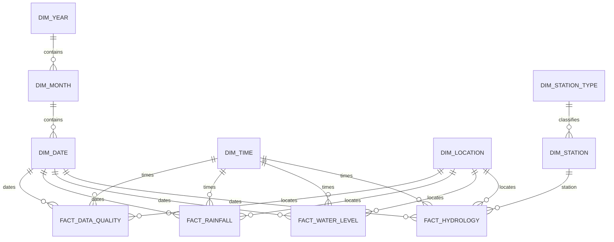

# SYSTEM AUDIT — PHÂN TÍCH HIỆN TRẠNG HỆ THỐNG

## 1. Executive Summary — Tóm tắt điều hành

Dự án là nền tảng data lakehouse phục vụ phân tích thủy văn, đánh giá rủi ro ngập và chuẩn bị dữ liệu machine learning dự báo mực nước tại Cần Thơ.

Các lớp chính đã xác minh:

- Batch ingestion từ CSV/XLSX vào MinIO Bronze.
- Xử lý Silver bằng PySpark và Apache Iceberg.
- Gold hourly cho weather, rainfall, water level, tide và river discharge.
- Streaming thử nghiệm qua Kafka.
- Data warehouse dimensional trong `lakehouse.dw`.
- Trino để truy vấn.
- dbt cho marts phân tích.
- Airflow cho validation và monitoring.
- Superset cho trực quan hóa.

Các report trong repository cho thấy nhiều pipeline đã chạy thành công trong các thời điểm trước đây. Tuy nhiên, chưa thể xác nhận trạng thái live hiện tại vì audit này không kết nối trực tiếp đến MinIO, Hive Metastore, Trino, Kafka hoặc Spark cluster.

Các kết quả chính:

- Gold batch có artifact xác minh 73.656 dòng cho timeline 2018-04-25 đến 2026-09-18.
- Water level có 54.982 dòng; tide có 43.822 dòng.
- Chỉ có 39.571/73.656 giờ đầy đủ cả năm nguồn.
- Tide bao phủ khoảng 59,5% toàn bộ timeline.
- Iceberg tables không có primary key, foreign key, unique constraint hoặc index vật lý.
- Gold contract vẫn ở trạng thái `draft`, location mapping ở trạng thái `pending_verification`.
- ML contract được đánh dấu `VALIDATED`, nhưng vẫn có trường `TO_BE_VERIFIED` và `UNVERIFIED`.
- Có credential mặc định và mật khẩu development hard-code.
- Không tìm thấy frontend hoặc business REST API.

Audit chỉ đọc. Không source code, schema hoặc dữ liệu nào bị thay đổi trong quá trình khảo sát.

## 2. System Architecture — Kiến trúc hệ thống

```mermaid
flowchart LR
    A[Raw CSV/XLSX Sources] --> B[Batch Ingestion]
    B --> C[MinIO Object Storage]
    C --> D[Bronze Objects]
    D --> E[Bronze Quality Validation]
    E --> F[PySpark Silver Transformations]
    F --> G[Iceberg Silver Tables]
    G --> H[PySpark Gold Builders]
    H --> I[Iceberg Gold Tables]
    I --> J[Integrated Gold hourly_hydrology]
    J --> K[ML Data Product ml_hourly]

    L[Kafka water_level.raw] --> M[Streaming Consumer]
    M --> C
    D --> N[Streaming Bronze to Silver]
    N --> O[Streaming Silver]
    O --> P[Streaming Gold]
    P --> Q[Streaming Integrated Gold]

    J --> R[Warehouse Dimensions/Facts]
    R --> S[dbt Staging]
    S --> T[dbt Intermediate]
    T --> U[dbt Marts]
    I --> V[Trino]
    U --> V
    V --> W[Superset]
    X[Airflow DAGs] --> E
    X --> V
    X --> O
```



### Công nghệ xác minh được

| Thành phần | Công nghệ | Bằng chứng |
|---|---|---|
| Object storage | MinIO/S3-compatible | `docker-compose.yml:5-23` |
| Table format | Apache Iceberg/Parquet | Các lệnh `USING iceberg` trong source |
| Processing | Apache Spark/PySpark | `requirements.txt`, `transformation/silver/common.py:240` |
| Metadata catalog | Apache Hive Metastore 3.1.3 | `docker/hive/Dockerfile.hive3:1` |
| Metastore DB | PostgreSQL 16 | `docker-compose.yml:29-54` |
| Streaming | Apache Kafka 4.1.2 | `docker/kafka/docker-compose.yml:3-46` |
| Query engine | Trino 476 | `trino/docker-compose.yml:1-20` |
| Transformation marts | dbt | `dbt/flood_analytics/dbt_project.yml` |
| Orchestration | Apache Airflow 3.1.5 | `airflow/docker-compose.yml:4-18` |
| Visualization | Apache Superset | `docker-compose.yml:91-126` |
| Data quality | Great Expectations và custom PySpark checks | `quality/`, `streaming/quality/` |

### Authentication và authorization

Không tìm thấy business API hoặc RBAC thống nhất. Kafka chạy `PLAINTEXT`, replication factor bằng 1; Superset, MinIO và PostgreSQL dùng credential cố định trong Docker Compose. Airflow có secret tĩnh tại `airflow/docker-compose.yml:11-12`.

Đây là cấu hình phù hợp cho local/demo nhưng chưa phù hợp production.

## 3. Project Structure — Cấu trúc source code

| Thư mục | Chức năng |
|---|---|
| `ingestion/` | Batch ingestion, backfill, Open-Meteo API |
| `transformation/silver/` | Chuẩn hóa Bronze thành Silver |
| `transformation/gold/` | Tổng hợp dữ liệu theo giờ |
| `streaming/producer/` | Replay water-level vào Kafka |
| `streaming/consumer/` | Kafka sang MinIO Bronze |
| `streaming/silver/` | Streaming Bronze sang Silver |
| `streaming/gold/` | Silver streaming sang hourly Gold |
| `streaming/integration/` | Kết hợp streaming Gold với batch Gold |
| `quality/` | Kiểm tra raw, Bronze, Silver, Gold và coverage |
| `warehouse/` | DDL, dimensions, facts, profiling |
| `dbt/flood_analytics/` | Staging, intermediate, marts và SQL tests |
| `airflow/dags/` | Batch, streaming và quality monitoring |
| `contracts/` | Data contract cho ML |
| `config/` | Source rules, quality rules, Gold contract |
| `demo/iceberg/` | Snapshot, time travel, schema evolution, partitioning |
| `test/` | Spark, MinIO, Iceberg và runtime tests |
| `reports/` | Profiling, validation và demo artifacts |
| `docker/` | Kafka, Hive, Superset configuration |
| `trino/` | Trino và Iceberg catalog configuration |

Không tìm thấy `frontend/`, `backend/`, `api/`, controller, route hoặc service FastAPI/Flask/Django.

## 4. Module Status — Trạng thái từng module

| Module | Chức năng | Trạng thái | Bằng chứng | Vấn đề tồn tại |
|---|---|---|---|---|
| Batch ingestion | CSV/XLSX, checksum, ghi Bronze | Đã triển khai, có report | `ingestion/batch/ingest_to_bronze.py:292-495` | Chưa xác nhận live storage |
| Raw backfill | Bổ sung dữ liệu từ Open-Meteo | Đã triển khai | `ingestion/backfill/backfill_open_meteo.py:33-64` | Phụ thuộc API ngoài |
| Bronze validation | Schema, timestamp, numeric, null | Đã triển khai | `quality/validate_bronze.py` | Report có thể đã cũ |
| Weather Silver | Chuẩn hóa thời tiết | Đã triển khai | `transformation/silver/weather_to_silver.py:122-311` | Initial load dùng replace |
| Rainfall Silver | Chuẩn hóa mưa | Đã triển khai | `transformation/silver/rainfall_to_silver.py:119-260` | Không có constraint vật lý |
| Water-level Silver | Đọc XLSX, station/timestamp | Đã triển khai | `transformation/silver/water_level_to_silver.py:193-600` | Phụ thuộc schema XLSX |
| Tide Silver | CSV/XLSX và recovery | Đã triển khai | `transformation/silver/tide_to_silver.py:170-809` | Rủi ro encoding |
| Discharge Silver | Chuẩn hóa lưu lượng ngày | Đã triển khai | `transformation/silver/river_discharge_to_silver.py:118-304` | Mở rộng hourly ở Gold |
| Batch Gold | Tạo hourly tables | Đã triển khai, có PASS report | `transformation/gold/`, `reports/gold/quality/` | Baseline chưa đồng nhất |
| Integrated Gold | Kết hợp năm nguồn | Đã triển khai, có PASS report | `transformation/gold/build_hourly_hydrology.py:174-257` | Contract còn draft |
| Kafka producer/consumer | Replay và Bronze streaming | Đã triển khai cho mô phỏng | `streaming/producer/`, `streaming/consumer/` | Chưa phải sensor ingestion thật |
| Streaming Silver/Gold | Dedup, hourly aggregation | Đã triển khai | `streaming/silver/`, `streaming/gold/` | Physical idempotency chưa chứng minh |
| Warehouse | 8 dimensions, 4 facts | Đã triển khai, có dictionary | `warehouse/ddl/warehouse_snowflake_ddl.sql` | FK chỉ kiểm tra trong code |
| dbt marts | 5 bảng marts | Đã triển khai | `dbt/flood_analytics/target/manifest.json` | Chưa xác minh runtime hiện tại |
| Airflow | Validation/monitoring DAGs | Đã triển khai | `airflow/dags/*.py` | `schedule=None`, chủ yếu manual |
| ML data product | `iceberg.gold.ml_hourly` | Có validation PASS artifact | `contracts/ml_hourly/validation_report.json` | Snapshot live chưa xác nhận |
| Frontend/business API | Giao diện nghiệp vụ | Chưa triển khai trong repo | Không tìm thấy application server | Superset chỉ là BI |

Đánh giá tổng thể: hệ thống đã đạt mức prototype/demo data platform có nhiều pipeline và validation artifact, nhưng chưa đủ bằng chứng để kết luận production-ready.

## 5. Database Schema — Cấu trúc dữ liệu

### 5.1. Tổng quan

| Nhóm | Số lượng xác minh |
|---|---:|
| Source datasets | 5 |
| Silver batch tables | 5 |
| Gold hourly source tables | 5 |
| Gold integrated table | 1 |
| Streaming Silver/Gold tables | Ít nhất 3 |
| Warehouse dimensions | 8 |
| Warehouse facts | 4 |
| dbt marts | 5 |
| ML data product | 1 |
| OLTP tables | Không xác minh được |

Database logic là Apache Iceberg. PostgreSQL được dùng làm metadata database cho Hive/Airflow, không phải business database.

### 5.2. Bronze

Bronze là object trong MinIO, không phải relational table cố định:

```text
bronze/{source}/ingestion_date={date}/batch_id={id}/{file}
```

Bằng chứng: `ingestion/batch/ingest_to_bronze.py:317-455`.

### 5.3. Silver batch tables

| Bảng | Business key | Trường canonical chính |
|---|---|---|
| `lakehouse.silver.weather` | `timestamp` | timestamp, temperature_c, humidity_pct, pressure_hpa, wind_speed, wind_direction, quality_flag, source_file |
| `lakehouse.silver.rainfall` | `timestamp` | timestamp, rainfall_mm, quality_flag, source_file |
| `lakehouse.silver.water_level` | `station_code + timestamp` | station_code, timestamp, water_level_m, unit, quality_flag, source_file |
| `lakehouse.silver.river_discharge` | `station + timestamp` | station, timestamp, discharge_m3s, quality_flag, source_file |
| `lakehouse.silver.tide` | `timestamp` | timestamp, tide_m, quality_flag, recovery_method, source_file |

Business keys được khai báo trong `config/silver_rules.yaml`.

### 5.4. Gold source tables

Theo `reports/gold/quality/gold_schema_inventory.json`:

| Bảng | Số dòng | Key logic | Trường chính |
|---|---:|---|---|
| `lakehouse.gold.weather_hourly` | 73.656 | `hour_start` | weather measures, quality/missing flags, coordinates, source metadata |
| `lakehouse.gold.rainfall_hourly` | 73.656 | `hour_start` | rainfall_mm, quality/missing flags, source metadata |
| `lakehouse.gold.discharge_hourly` | 73.656 | `station + hour_start` | discharge, alignment, source date, temporal grain |
| `lakehouse.gold.water_level_hourly` | 54.982 | `station_code + hour_start` | mean/min/max/last, counts, completeness, quality |
| `lakehouse.gold.tide_hourly` | 43.822 | `hour_start` | tide height, recovery flag, recovery method, quality |

Các schema cho phép nullable; primary key không được enforce tại storage layer.

### 5.5. Gold integrated

```text
lakehouse.gold.hourly_hydrology
```

Grain là `hour_start + location_id`, theo `config/gold_hourly_hydrology_contract.yaml:2-16`.

Nhóm trường gồm weather, rainfall, water level, tide, discharge, quality flags, present/usable flags và `gold_processed_at`. Bảng được xây từ canonical hourly timeline bằng `left join`, giữ null/missing measurements theo contract tại `config/gold_hourly_hydrology_contract.yaml:128-152`.

### 5.6. Streaming tables

`lakehouse.silver.water_level_stream` được định nghĩa tại `streaming/silver/bronze_to_silver.py:329-344`, gồm `event_id`, timestamp, station_code, water_level_m, quality flag, source, Kafka metadata và `silver_processed_at`. MERGE theo `event_id` tại dòng 395-424.

`lakehouse.gold.water_level_hourly_stream` tổng hợp theo `station_code + hour_timestamp` trong `streaming/gold/silver_to_hourly.py:70-170`.

`lakehouse.gold.hourly_hydrology_stream` được tạo bởi `streaming/integration/merge_integrated.py`, với key gồm `hour_start + location_id + station_code`.

### 5.7. Warehouse dimensions

DDL tại `warehouse/ddl/warehouse_snowflake_ddl.sql:5-61`:

| Bảng | Trường |
|---|---|
| `dim_year` | year_key, calendar_year |
| `dim_month` | month_key, year_key, month_number, quarter_number |
| `dim_date` | date_key, full_date, month_key, day_of_month, day_of_week |
| `dim_time` | time_key, hour_of_day, time_label, day_part |
| `dim_region` | region_key, region_name |
| `dim_location` | location_key, location_id, region_key, location_name |
| `dim_station_type` | station_type_key, station_role, description |
| `dim_station` | station_key, station_type_key, station_source_id, station_name, publisher |

Dictionary artifact ghi nhận `dim_region` có 0 dòng và `dim_location` có 1 dòng.

### 5.8. Warehouse facts

| Bảng | Grain | Trường chính |
|---|---|---|
| `fact_hydrology` | hour_start × location | tất cả measurement tổng hợp |
| `fact_water_level` | hour_start × location | water-level metrics, completeness, quality |
| `fact_rainfall` | hour_start × location | rainfall và quality |
| `fact_data_quality` | hour_start × location | trạng thái present/usable của năm nguồn |

DDL tại `warehouse/ddl/warehouse_snowflake_ddl.sql:64-151`.

## 6. Entity Relationships — Quan hệ dữ liệu



Các quan hệ trên là quan hệ logic. DDL không tạo `PRIMARY KEY`, `FOREIGN KEY`, `UNIQUE` hoặc `INDEX`. `warehouse/facts/load_facts.py` kiểm tra dimension key trước khi ghi fact.

Quan hệ nghiệp vụ chính:

- Weather, rainfall, discharge và tide nối theo `hour_start`.
- Water level nối theo `station_code + hour_start`.
- Tất cả source được gắn với `CAN_THO_URBAN_CENTER`.
- Discharge daily được mở rộng thành hourly với semantics `DAILY_EXPANDED`.
- Tide có thể có trạng thái `RECOVERED`.
- Streaming water level được nối với batch Gold bằng station và hourly key.

## 7. Business Flows & APIs — Luồng nghiệp vụ và API

### Batch ingestion

1. File được phát hiện trong `data/raw/*`.
2. `ingestion/batch/ingest_to_bronze.py:292-340` xây object path.
3. File được checksum và đếm record.
4. File được upload vào MinIO tại dòng 442-455.
5. Quality report được ghi trong `reports/quality/`.
6. Silver transformation đọc Bronze và tạo Iceberg table.
7. Gold builder tạo bảng hourly.

### Silver transformation

| Nguồn | Handler | Xử lý |
|---|---|---|
| Weather | `transform_weather()` | parse timestamp, rename, cast, quality flag |
| Rainfall | `transform_rainfall()` | parse timestamp, cast, missing policy |
| Water level | `transform_water_level()` | đọc XLSX, station mapping, timestamp normalization |
| Tide | `transform_to_silver()` | đọc CSV/XLSX, Excel recovery |
| Discharge | `transform_river_discharge()` | giữ daily grain |

### Gold integrated

`build_hourly_hydrology.py:create_timeline()` tạo timeline; `prepare_source()` chuẩn hóa từng nguồn; các nguồn được `left join`; quality flags và present/usable flags được tính; validation kiểm tra key, null, duplicate và coverage.

### Streaming

1. Producer đọc Silver water-level và tạo event.
2. Event gửi tới Kafka topic `hydrology.water_level.raw`.
3. Consumer lưu raw payload vào MinIO.
4. Streaming Silver parse, validate và MERGE theo `event_id`.
5. Streaming Gold aggregate theo station/hour.
6. Integrated streaming Gold merge với batch Gold.

### API và endpoint hạ tầng

| Phương thức | Endpoint/topic | Chức năng |
|---|---|---|
| HTTP POST/GET | `http://cantho-flood-trino:8080/v1/statement` | Gửi SQL tới Trino |
| Kafka | `hydrology.water_level.raw` | Streaming water-level events |
| S3 API | MinIO endpoint từ `.env` | Upload/read Bronze |
| Thrift | `thrift://hive-metastore:9083` | Hive metadata catalog |
| HTTP | Superset `:8088` | BI visualization |
| HTTP | Airflow `127.0.0.1:8089` | DAG operations |

Không có business REST API được xác minh.

## 8. Technical Issues — Vấn đề kỹ thuật

| Mức độ | Vấn đề | Bằng chứng | Ảnh hưởng |
|---|---|---|---|
| Critical | Credential mặc định/hard-code | `docker-compose.yml:14-16,36-37,109-115` | Rủi ro truy cập trái phép |
| Critical | Kafka PLAINTEXT, replication factor 1 | `docker/kafka/docker-compose.yml:25-35` | Mất dữ liệu, không bảo mật |
| High | Chưa xác minh live deployment | Chỉ có report artifacts | Không biết trạng thái hiện tại |
| High | Coverage nguồn không đồng đều | `reports/gold/quality/cross_source_coverage.json` | Chỉ 53,15% giờ có đủ năm nguồn usable |
| High | Tide thiếu dữ liệu 2018-2020 và 2026 | `gold_coverage_revalidation.json` | Hạn chế phân tích/ML |
| High | Không có PK/FK/unique/index vật lý | `warehouse/ddl/warehouse_snowflake_ddl.sql` | Rủi ro duplicate/join sai |
| High | Gold contract còn draft | `config/gold_hourly_hydrology_contract.yaml:2-16` | Chưa đủ cơ sở publish authoritative data product |
| Medium | Baseline config/report không đồng nhất | `config/gold_quality_rules.yaml`, các report Gold | False failure hoặc false pass |
| Medium | Snapshot Integrated đổi khi rerun | `reports/streaming_demo/final/final_demo_report.json` | Idempotency vật lý chưa chứng minh |
| Medium | `dim_region` có 0 dòng | `reports/warehouse/documentation/data_dictionary.md` | Dimension model chưa hoàn chỉnh |
| Medium | Chưa xác minh CI/CD | Không tìm thấy workflow/coverage config | Chất lượng phụ thuộc thủ công |
| Medium | Airflow DAG dùng `schedule=None` | `airflow/dags/*.py` | Monitoring chưa tự động |
| Medium | Silver dùng `createOrReplace()` | Các file `transformation/silver/` | Có nguy cơ overwrite |
| Low | Spark temp JAR cleanup warnings | `reports/iceberg/logs/09_partition_readonly_verified_20261007.txt` | Nhiễu vận hành |
| Low | Encoding source tide không ổn định | `config/silver_rules.yaml` | Rủi ro column matching |

## 9. Risks & Technical Debt — Rủi ro và nợ kỹ thuật

Theo `cross_source_coverage.json`:

| Dataset | Present | Usable |
|---|---:|---:|
| Weather | 100% | 99,9769% |
| Rainfall | 100% | 99,9769% |
| Discharge | 100% | 100% |
| Water level | 74,647% | 73,9722% |
| Tide | 59,4955% | 59,4955% |
| Tất cả năm nguồn | 53,7241% | 53,1525% |

Water-level có 125 giờ incomplete và 372 giờ off-grid. Tide có 4.986 giờ recovered và 29.834 giờ thiếu so với timeline chung.

Các rủi ro khác:

- Schema gần như toàn bộ nullable.
- Constraint quan trọng chỉ tồn tại trong code.
- Station/location mapping phụ thuộc hard-code.
- Daily discharge được mở rộng hourly và cần bảo toàn semantics.
- Kafka chưa có schema registry.
- Chưa thấy backup/restore, disaster recovery hoặc snapshot retention policy.

## 10. Recommended Roadmap — Lộ trình đề xuất

### Giai đoạn 1: Production safety

- Thay credential mặc định bằng secret manager hoặc Docker secrets.
- Bật TLS/SASL cho Kafka.
- Thêm authentication cho Trino, Superset và Airflow.
- Tách development/staging/production configuration.
- Thiết lập backup/restore cho MinIO, Hive Metastore và Airflow metadata.

### Giai đoạn 2: Data contract và schema governance

- Xác minh location, station mapping, wind speed unit và vertical datum.
- Chuyển Gold contract khỏi `draft` sau khi được phê duyệt.
- Chuẩn hóa expected counts và quality baseline.
- Version hóa Kafka event schema.
- Đưa metadata version vào Gold tables.

### Giai đoạn 3: Data quality và coverage

- Xử lý coverage thiếu của tide.
- Xử lý water-level off-grid và incomplete hours.
- Bổ sung unit/range/freshness/late-arriving checks.
- Đưa cross-source coverage thành quality gate cho ML product.

### Giai đoạn 4: Storage integrity và performance

- Chuẩn hóa business key.
- Bổ sung uniqueness và FK validation sau mỗi write.
- Tối ưu Iceberg partitioning và compaction.
- Theo dõi small files.
- Thiết lập snapshot retention/vacuum policy.

### Giai đoạn 5: Orchestration và delivery

- Thiết lập schedule thực tế cho Airflow.
- Thêm retry, timeout, alerting và SLA.
- Thiết lập CI cho Python, PySpark, dbt và SQL tests.
- Tạo production runbook và rollback procedure.

## 11. Unverified Areas — Những nội dung chưa thể xác minh

- Trạng thái live của MinIO, Hive, PostgreSQL, Kafka, Trino, Airflow và Superset.
- Dữ liệu hiện tại trong object storage và Iceberg catalog.
- Snapshot Iceberg hiện tại.
- Performance thực tế của Spark/Trino.
- Authentication/authorization runtime.
- Backup, restore và disaster recovery.
- CI/CD ngoài repository.
- Độ chính xác của station/location mapping.
- Vertical datum và tính pháp lý của ngưỡng cảnh báo.
- Wind speed unit.
- Frontend/business API bên ngoài repository.

## 12. Kết luận

Hệ thống đã có kiến trúc lakehouse rõ ràng và nhiều bằng chứng kiểm thử thành công cho batch, streaming, Iceberg, warehouse và ML contract. Hệ thống hiện phù hợp hơn với prototype hoặc môi trường nghiên cứu có kiểm soát. Các rào cản trước production gồm bảo mật yếu, thiếu constraint vật lý, coverage chưa đầy đủ, contract chưa hoàn tất, thiếu live verification và thiếu CI/CD/monitoring tự động.

## 13. 10 công việc ưu tiên tiếp theo

1. Xác minh live stack và snapshot hiện tại của MinIO, Hive, Trino, Kafka và Iceberg.
2. Xóa credential mặc định, chuyển sang secret management.
3. Bật TLS/SASL cho Kafka và authentication cho dịch vụ quản trị.
4. Hoàn tất location, station mapping, wind speed unit và vertical datum.
5. Chuẩn hóa expected counts và quality baseline.
6. Xử lý coverage thiếu của tide và incomplete/off-grid water-level.
7. Bổ sung uniqueness, foreign-key validation và schema checks thành quality gate.
8. Chuẩn hóa partitioning, compaction và snapshot retention cho Iceberg.
9. Thiết lập Airflow schedule, retry, alerting và freshness monitoring.
10. Thiết lập CI/CD cho Python, PySpark, dbt, SQL tests và deployment configuration.
